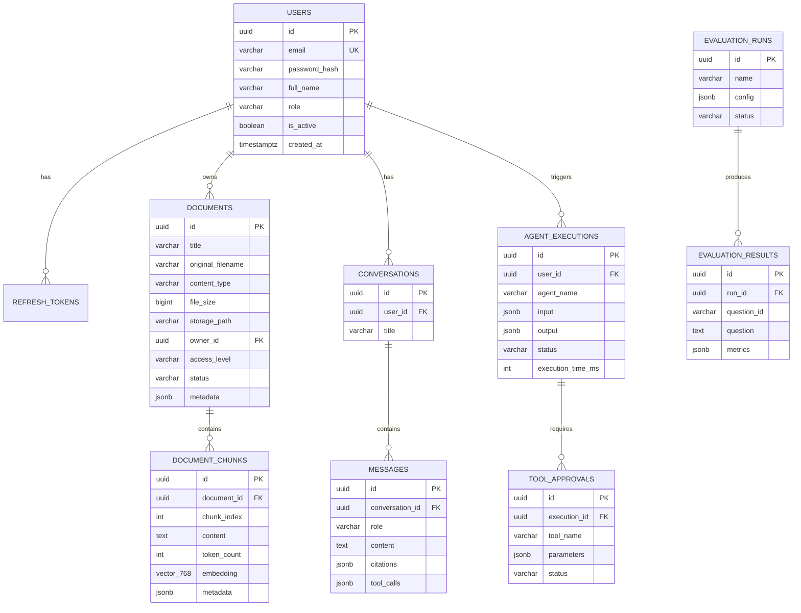

# Database Schema

PostgreSQL 16 + pgvector 0.7+. Schema is created by `database/init/001_init.sql` on first container start and by EF Core migrations thereafter.

## Entity Relationship Diagram



## Tables

### `users`
| Column | Type | Notes |
|--------|------|-------|
| id | uuid PK | `gen_random_uuid()` |
| email | varchar(255) UK | Lowercase, unique |
| password_hash | varchar(255) | BCrypt |
| full_name | varchar(255) | Optional |
| role | varchar(50) | `Admin` / `User`, default `User` |
| is_active | boolean | Soft delete, default true |
| created_at / updated_at | timestamptz | UTC |

### `documents`
| Column | Type | Notes |
|--------|------|-------|
| id | uuid PK | |
| title / original_filename | varchar(500) | |
| content_type | varchar(100) | `application/pdf`, `application/vnd.openxmlformats-officedocument.wordprocessingml.document` |
| file_size | bigint | Bytes |
| storage_path | varchar(1000) | Local uploads path |
| owner_id | uuid FK → users | SET NULL |
| access_level | varchar(50) | `Private` / `Team` / `Public` |
| status | varchar(50) | `Processing` / `Ready` / `Failed` |
| metadata | jsonb | Page count, chunking config, etc. |

### `document_chunks`
| Column | Type | Notes |
|--------|------|-------|
| id | uuid PK | |
| document_id | uuid FK → documents | CASCADE delete |
| chunk_index | int | Unique per document |
| content | text | Extracted text chunk |
| token_count | int | Approximate token count |
| embedding | vector(768) | nomic-embed-text output |
| metadata | jsonb | Page number, heading, overlap info |

**Indexes**
- `ix_document_chunks_document_id` (btree)
- `ix_document_chunks_document_chunk_index` (unique composite)
- `ix_document_chunks_embedding` — **HNSW**, `vector_cosine_ops`, `m=16`, `ef_construction=64`

### `conversations` / `messages`
Conversation belongs to a user; messages belong to a conversation. `role` ∈ `user`, `assistant`, `system`, `tool`. `citations` and `tool_calls` are `jsonb`.

### `agent_executions` / `tool_approvals`
Execution status: `Running`, `Completed`, `Failed`, `PendingApproval`. Tool approvals record requested parameters, decided-by admin, and reason.

### `evaluation_runs` / `evaluation_results`
Run config and per-question metrics stored as `jsonb` (recall@k, MRR, nDCG, faithfulness, answer relevance, correctness, latency).

## Vector Search Query Pattern

```sql
SELECT
    dc.id, dc.document_id, dc.content,
    1 - (dc.embedding <=> $1::vector) AS similarity
FROM document_chunks dc
JOIN documents d ON d.id = dc.document_id
WHERE dc.embedding IS NOT NULL
  AND d.status = 'Ready'
  AND (d.access_level = 'Public' OR d.owner_id = $2 OR $3 = true)
ORDER BY dc.embedding <=> $1::vector
LIMIT $4;
```

`$1` = query embedding, `$2` = current user id, `$3` = is admin, `$4` = top-k.

## Seed Data

`database/seed/seed.sql` inserts:
- `admin@nexai.local` / `Admin123!` (role `Admin`)
- `user@nexai.local` / `User123!` (role `User`)

Passwords are BCrypt hashes generated at seed time (never plaintext in source).
